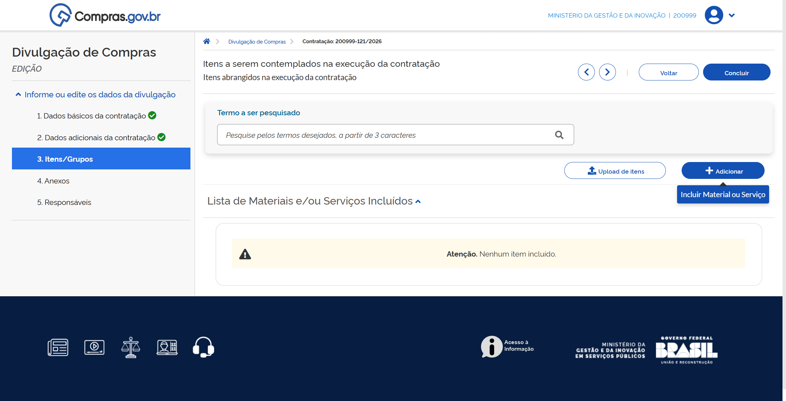
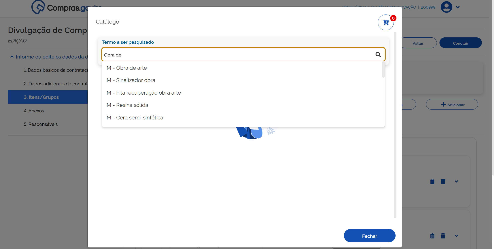

  Tamanho do texto:
  <button onclick="diminuirFonte()" title="Diminuir texto" style="padding: 6px 12px; font-weight: bold; cursor: pointer; border: 1px solid #ccc; border-radius: 4px; background: #f8f9fa;">A-</button>
  <button onclick="resetarFonte()" title="Tamanho normal" style="padding: 6px 12px; font-weight: bold; cursor: pointer; border: 1px solid #ccc; border-radius: 4px; background: #f8f9fa;">A</button>
  <button onclick="aumentarFonte()" title="Aumentar texto" style="padding: 6px 12px; font-weight: bold; cursor: pointer; border: 1px solid #ccc; border-radius: 4px; background: #f8f9fa;">A+</button>
  
  <button onclick="window.print()" style="background-color: #0056b3; color: white; padding: 6px 16px; border: none; border-radius: 5px; font-size: 14px; cursor: pointer; box-shadow: 0 2px 4px rgba(0,0,0,0.2); margin-left: 10px;">
    🖨️ Imprimir ou baixar esta página
  </button>

# 3. INCLUSÃO DE ITENS E FORMAÇÃO DE GRUPOS

Agora existem duas formas de incluir itens em sua contratação: a partir da integração com o Catálogo para pesquisa ou por meio de planilha de itens previamente preenchida[cite: 8].

## 1. Inclusão de itens a partir da integração com o Catálogo

**Passo 18:** Na aba Itens/Grupos, serão realizadas as inclusões dos itens da contratação[cite: 8]. Para incluir diretamente do Catálogo integrado ao Novo DC, clique em "+Adicionar"[cite: 8].

**Passo 19:** Pesquise pelos termos desejados[cite: 8].

**Passo 20:** Escolha se é material ou serviço e procure pelo item desejado[cite: 8]. Quando encontrado, clique em "Detalhar". Em seguida em clique em "+"[cite: 8].

**Passo 21:** Verifique a unidade de fornecimento, inclua o valor unitário e clique em "Salvar"[cite: 8]. Repita os passos 18 a 21 para todos os itens de sua contratação[cite: 8].

**Passo 22:** Depois de inseridos todos os itens, clique no carrinho localizado no canto superior direito[cite: 8].

**Passo 23:** Confirme a inclusão dos itens do carrinho[cite: 8].

Pronto. Seus itens foram adicionados a sua contratação[cite: 9]. Para finalizar a configuração de seus itens vá para o passo 28[cite: 9].

## 2. Inclusão de itens por meio de uma planilha eletrônica

Siga os passos abaixo para adicionar itens usando uma planilha eletrônica[cite: 9].

**Passo 24:** Na aba Itens/Grupos, localize o ícone "Upload de itens"[cite: 9].

!!! warning "Atenção"
    O sistema apresentará um link com modelo de planilha para ser seguido[cite: 9]. É importante que esse modelo seja seguido para a correta importação dos itens[cite: 9].

**Passo 25:** Faça o download da planilha de modelo e siga a ordem das colunas indicadas[cite: 9].

**Passo 26:** Finalizada a edição de sua planilha, carregue no sistema clicando no botão "Selecione arquivo", carregue o documento e clique em "Confirmar"[cite: 9]. O sistema apresentará tela indicando que o carregamento dos itens foi iniciado com sucesso[cite: 9]. 

Para acompanhar relatório de importação, clique em "Acompanhar importação de itens"[cite: 9]. O relatório apresentado indicará os possíveis erros no carregamento de dados[cite: 9]. Se necessário, corrija os erros indicados no relatório e importe sua planilha novamente[cite: 9].

**Passo 27:** Finalizado o processo de upload da planilha, retorne para a tela de sua contratação para finalizar a configuração de seus itens[cite: 9].

**Passo 28:** Para prosseguir com a configuração dos itens de sua licitação, clique em "Expandir"[cite: 9].

**Passo 29:** Em Detalhes, selecione o Critério de Julgamento[cite: 9].

**Passo 30:** Selecione o Tipo de variação de lances e o Intervalo Mínimo Entre Lances[cite: 9].

**Passo 31:** Em seguida, clique em "Salvar"[cite: 10].

**Passo 32:** Em Locais de Entrega, clique em "+Local de entrega"[cite: 10].

**Passo 33:** Adicione um local de entrega e a quantidade de itens que deverão ser entregues nesse local[cite: 10].

!!! note "Nota"
    Pode ser incluído mais de um (1) local de entrega[cite: 10].

!!! warning "Atenção"
    Você também poderá atribuir um local de entrega a vários itens simultaneamente[cite: 10].

**Passo 34:** Para isso, na página inicial dos itens da contratação, selecione os itens que têm o mesmo endereço de entrega, clicando na caixa ao lado da descrição dos itens e clique em "Adicionar Locais de Entrega"[cite: 10].

**Passo 35:** Atribua o endereço de entrega para todos os itens e as quantidades individuais[cite: 10].

**Passo 36:** Salve as informações[cite: 10].

**Passo 37:** Na aba Benefícios, poderão ser atribuídos Benefícios para ME/EEPP, margem de preferência e exigência de conteúdo nacional[cite: 10]. Se precisar de ajuda sobre cada tipo de benefício, clique no ícone ? para acessar o conteúdo de ajuda[cite: 10]. Repita os passos acima para todos os itens da contratação[cite: 10].

## Como formar grupos de itens em licitações

Você poderá formar grupos de itens para sua contratação[cite: 10]. Para isso, siga os passos abaixo[cite: 10].

**Passo 38:** Na aba Itens/Grupos, selecione os itens que deseja agrupar, e clique em "Criar Grupo"[cite: 10].

**Passo 39:** Dê um Apelido para o grupo[cite: 11].

**Passo 40:** Selecione o critério de julgamento e clique em "Confirmar"[cite: 11].

**Passo 41:** Atribua os benefícios ao grupo e salve[cite: 11].

**Passo 42:** Finalize a configuração dos itens do grupo e clique em "Salvar"[cite: 11].

 

  <button onclick="window.print()" style="background-color: #0056b3; color: white; padding: 10px 20px; border: none; border-radius: 5px; font-size: 16px; cursor: pointer; box-shadow: 0 2px 4px rgba(0,0,0,0.2);">
  🖨️ Imprimir ou baixar esta página
  </button>

