

  Tamanho do texto:
  <button onclick="diminuirFonte()" title="Diminuir texto" style="padding: 6px 12px; font-weight: bold; cursor: pointer; border: 1px solid #ccc; border-radius: 4px; background: #f8f9fa;">A-</button>
  <button onclick="resetarFonte()" title="Tamanho normal" style="padding: 6px 12px; font-weight: bold; cursor: pointer; border: 1px solid #ccc; border-radius: 4px; background: #f8f9fa;">A</button>
  <button onclick="aumentarFonte()" title="Aumentar texto" style="padding: 6px 12px; font-weight: bold; cursor: pointer; border: 1px solid #ccc; border-radius: 4px; background: #f8f9fa;">A+</button>
  
  <button onclick="window.print()" style="background-color: #0056b3; color: white; padding: 6px 16px; border: none; border-radius: 5px; font-size: 14px; cursor: pointer; box-shadow: 0 2px 4px rgba(0,0,0,0.2); margin-left: 10px;">
    🖨️ Imprimir ou baixar esta página
  </button>

PÚBLICO-ALVO: AGENTES DE CONTRATAÇÃO

# Tutorial: Licitações eletrônicas no Novo DC

Agora todas as licitações eletrônicas são realizadas exclusivamente pelo Novo Divulgação de Compras (Novo DC), disponível no sistema Compras.gov.br. Neste tutorial, abordamos o passo a passo para publicação de uma concorrência eletrônica no Novo DC, abrangendo a criação da contratação, preenchimento de dados, inclusão de itens e Intenção de Registro de Preços (IRP).

 

# 1. CRIAR A CONTRATAÇÃO

**Passo 1:** Acesse o Portal de Compras do Governo Federal e clique em "Acesso ao Sistema".

**Passo 2:** Escolha o perfil Governo e clique em "Entrar com Gov.br".

**Passo 3:** Na área de trabalho do usuário Governo, clique em "Novo Divulgação de Compras".

**Passo 4:** E em seguida clique em "+Criar".

**Passo 5:** Preencha todas as informações relacionadas ao processo e clique em "Concluir".

 

# 2. PREENCHIMENTO DE DADOS DA CONTRATAÇÃO

**Passo 6:** Encontre a contratação desejada na aba Contratações Minhas Uasg. Em seguida, clique em "Editar".

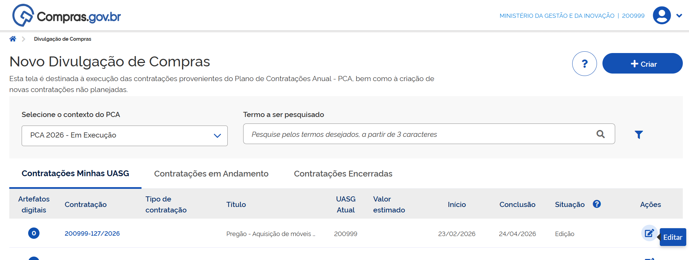

**Passo 7:** Na aba Dados Básicos da Contratação, preencha o número do processo, o número de controle interno da UASG e, no Tipo de contratação, escolha a modalidade de licitação.

!!! note "Nota"
    O número de controle interno da UASG tem por objetivo permitir que cada órgão tenha seu controle de processos, registrado no sistema para melhor rastreabilidade. O preenchimento desse número é facultativo.

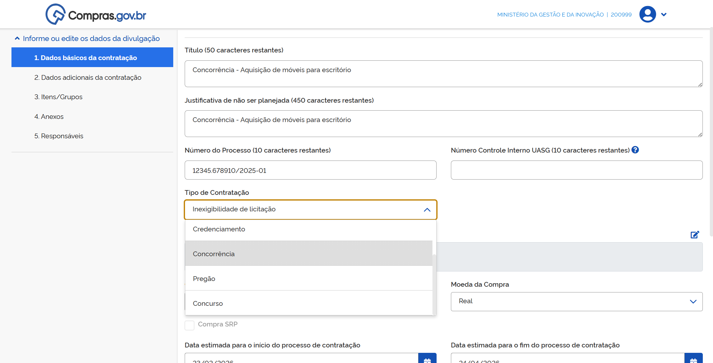

!!! warning "Atenção"
    Neste manual, faremos o passo a passo de uma concorrência, mas as demais modalidades seguem os mesmos passos.

**Passo 8:** Para definir o Fundamento legal da contratação, clique no ícone de lápis.

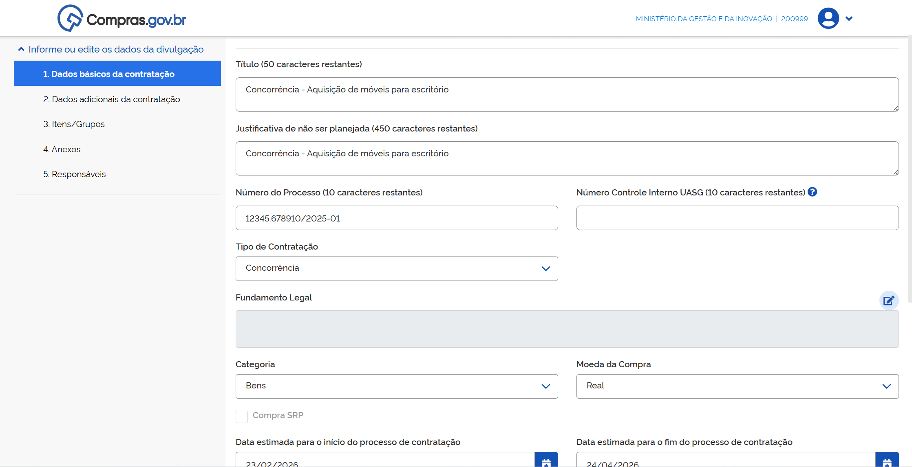

Navegue pela lista de fundamentos legais disponíveis no sistema. Detalhe os fundamentos legais disponíveis e quando localizar a opção adequada, clique sobre o texto e, em seguida, clique em "Salvar".

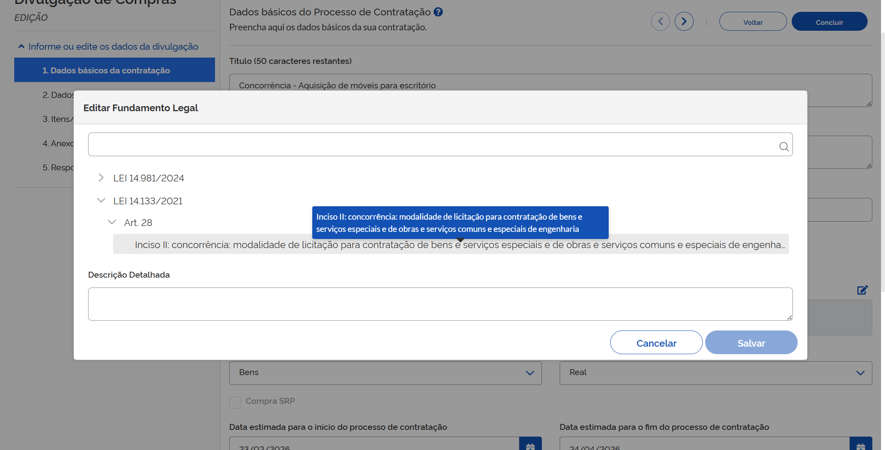

**Passo 9:** Em Modo de disputa, selecione a opção de acordo com a definição do edital - aberto, fechado, aberto/fechado ou fechado/aberto. Os modos de disputa exibidos em tela variam de acordo com a modalidade da licitação.

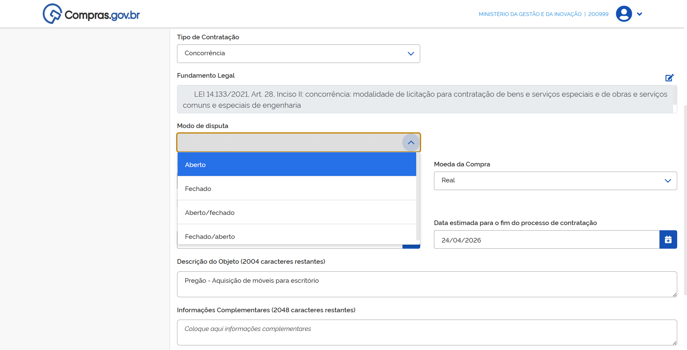

**Passo 10:** Em Critério de julgamento, selecione a opção adequada ao seu processo, em conformidade com seu edital.

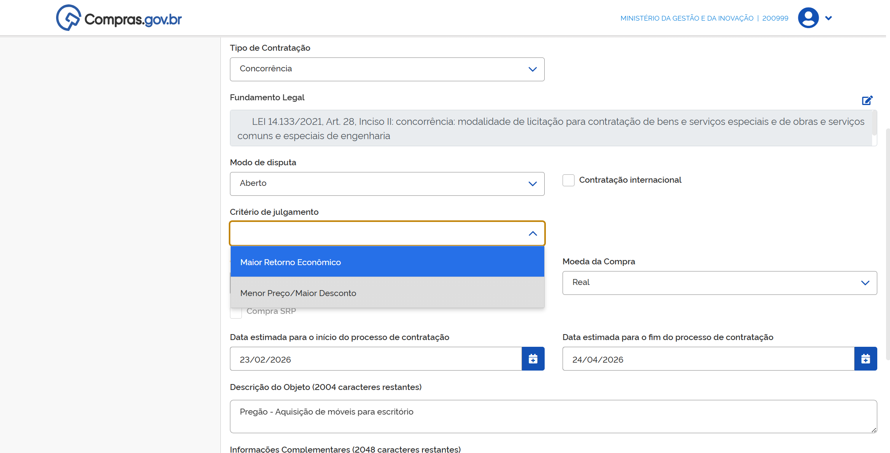

**Passo 11:** Em Forma de realização, selecione entre "eletrônico" e "presencial".

!!! note "Nota"
    A opção "Eletrônico" encaminhará seu processo para a sala de disputa virtual, onde fornecedores interessados se conectarão ao seu processo de forma virtual. Já a opção "Presencial" resultará na realização de sessão pública presencial, com a necessidade de documentação e registros em conformidade com a Lei nº 14.133/2021.

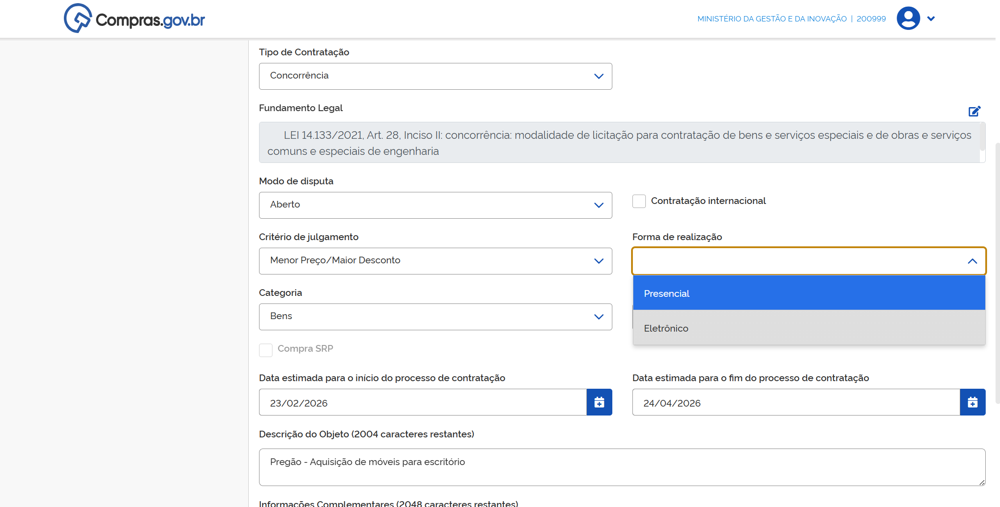

**Passo 12:** Selecione o Tipo de objeto a ser licitado na lista apresentada no sistema. Essa opção ajudará o sistema a definir seus prazos mínimos de publicidade.

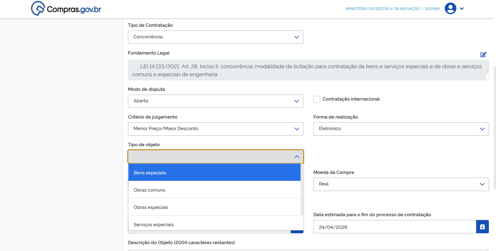

**Passo 13:** Para obras e serviços de engenharia, o sistema apresentará campo para informar Regime de execução do contrato.

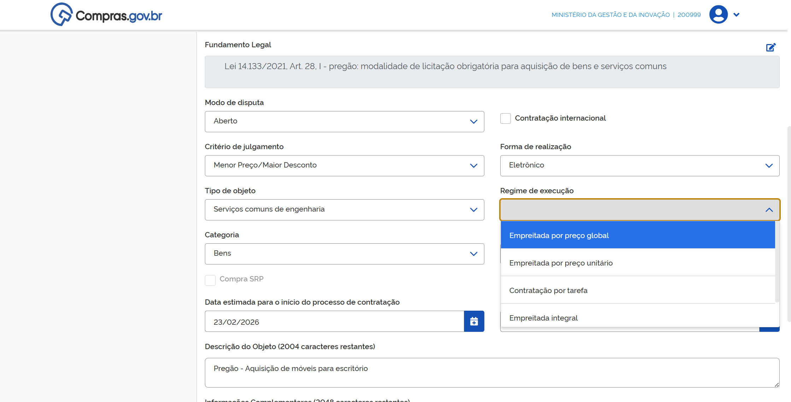

**Passo 14:** Preencha os campos de Categoria e Moeda da Compra. As demais informações contidas na tela correspondem às inseridas na criação da contratação e poderão ser editadas caso seja necessário.

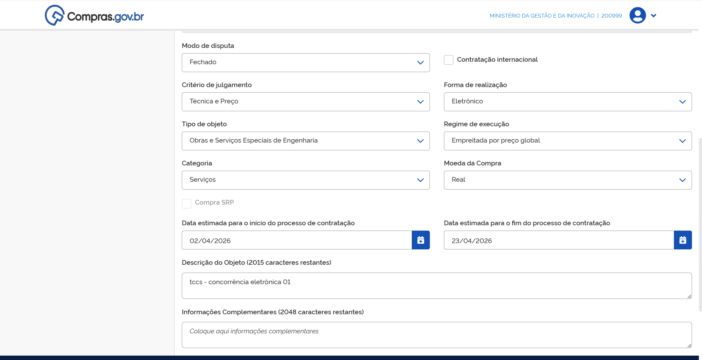

**Passo 15:** Na aba Dados adicionais da contratação, preencha os dados do empenho para a publicação no Diário Oficial da União. Se necessário, consulte os dados de seu órgão para o preenchimento correto das informações.

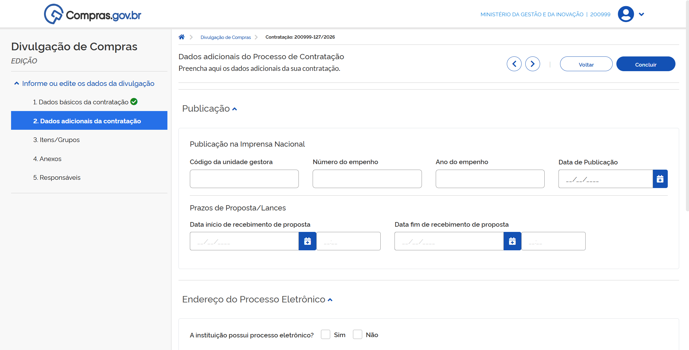

**Passo 16:** Preencha as datas importantes do seu certame Início e fim de recebimento de propostas. Seu certame será iniciado na data e na hora que você digitar no campo "Data fim de recebimento de propostas".

**Passo 17:** Por fim, caso o órgão ou entidade tenha processo eletrônico, preencha os dados de endereço do processo eletrônico referente a contratação e o Tipo de recurso, que poderá ser "Internacional", "Federal", "Distrital", "Estadual" ou "Municipal".

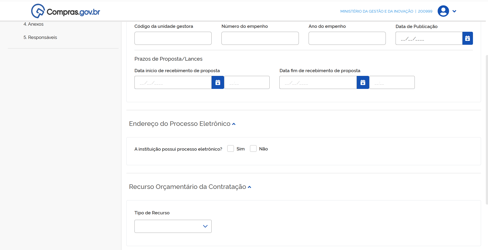

 

# 3. INCLUSÃO DE ITENS E FORMAÇÃO DE GRUPOS

Agora existem duas formas de incluir itens em sua contratação: a partir da integração com o Catálogo para pesquisa ou por meio de planilha de itens previamente preenchida.

## 1. Inclusão de itens a partir da integração com o Catálogo

**Passo 18:** Na aba Itens/Grupos, serão realizadas as inclusões dos itens da contratação. Para incluir diretamente do Catálogo integrado ao Novo DC, clique em "+Adicionar".

**Passo 19:** Pesquise pelos termos desejados.

**Passo 20:** Escolha se é material ou serviço e procure pelo item desejado. Quando encontrado, clique em "Detalhar". Em seguida em clique em "+".

**Passo 21:** Verifique a unidade de fornecimento, inclua o valor unitário e clique em "Salvar". Repita os passos 18 a 21 para todos os itens de sua contratação.

**Passo 22:** Depois de inseridos todos os itens, clique no carrinho localizado no canto superior direito.

**Passo 23:** Confirme a inclusão dos itens do carrinho.

Pronto. Seus itens foram adicionados a sua contratação. Para finalizar a configuração de seus itens vá para o passo 28.

## 2. Inclusão de itens por meio de uma planilha eletrônica

Siga os passos abaixo para adicionar itens usando uma planilha eletrônica.

**Passo 24:** Na aba Itens/Grupos, localize o ícone "Upload de itens".

!!! warning "Atenção"
    O sistema apresentará um link com modelo de planilha para ser seguido. É importante que esse modelo seja seguido para a correta importação dos itens.

**Passo 25:** Faça o download da planilha de modelo e siga a ordem das colunas indicadas.

**Passo 26:** Finalizada a edição de sua planilha, carregue no sistema clicando no botão "Selecione arquivo", carregue o documento e clique em "Confirmar". O sistema apresentará tela indicando que o carregamento dos itens foi iniciado com sucesso.

Para acompanhar relatório de importação, clique em "Acompanhar importação de itens". O relatório apresentado indicará os possíveis erros no carregamento de dados. Se necessário, corrija os erros indicados no relatório e importe sua planilha novamente.

**Passo 27:** Finalizado o processo de upload da planilha, retorne para a tela de sua contratação para finalizar a configuração de seus itens.

**Passo 28:** Para prosseguir com a configuração dos itens de sua licitação, clique em "Expandir".

**Passo 29:** Em Detalhes, selecione o Critério de Julgamento.

**Passo 30:** Selecione o Tipo de variação de lances e o Intervalo Mínimo Entre Lances.

**Passo 31:** Em seguida, clique em "Salvar".

**Passo 32:** Em Locais de Entrega, clique em "+Local de entrega".

**Passo 33:** Adicione um local de entrega e a quantidade de itens que deverão ser entregues nesse local.

!!! note "Nota"
    Pode ser incluído mais de um (1) local de entrega.

!!! warning "Atenção"
    Você também poderá atribuir um local de entrega a vários itens simultaneamente.

**Passo 34:** Para isso, na página inicial dos itens da contratação, selecione os itens que têm o mesmo endereço de entrega, clicando na caixa ao lado da descrição dos itens e clique em "Adicionar Locais de Entrega".

**Passo 35:** Atribua o endereço de entrega para todos os itens e as quantidades individuais.

**Passo 36:** Salve as informações.

**Passo 37:** Na aba Benefícios, poderão ser atribuídos Benefícios para ME/EEPP, margem de preferência e exigência de conteúdo nacional. Se precisar de ajuda sobre cada tipo de benefício, clique no ícone ? para acessar o conteúdo de ajuda. Repita os passos acima para todos os itens da contratação.

## Como formar grupos de itens em licitações

Você poderá formar grupos de itens para sua contratação. Para isso, siga os passos abaixo.

**Passo 38:** Na aba Itens/Grupos, selecione os itens que deseja agrupar, e clique em "Criar Grupo".

**Passo 39:** Dê um Apelido para o grupo.

**Passo 40:** Selecione o critério de julgamento e clique em "Confirmar".

**Passo 41:** Atribua os benefícios ao grupo e salve.

**Passo 42:** Finalize a configuração dos itens do grupo e clique em "Salvar".

 

# 4. ANEXOS, RESPONSÁVEIS E PUBLICAÇÃO

## Inclusão de anexos e artefatos vinculados

**Passo 43:** Na aba Anexos, podem ser vinculados artefatos digitais da contratação ou documentos complementares. Para vincular os artefatos, clique em "+Vincular".

**Passo 44:** Selecione o tipo de artefato para pesquisa.

**Passo 45:** Selecione o documento e clique em "Vincular".

**Passo 46:** Para anexar outros documentos, clique em "+Anexar".

**Passo 47:** Selecione o tipo de anexo para pesquisa.

**Passo 48:** Selecione o arquivo e clique em "Anexar".

!!! warning "Atenção"
    É necessário juntar, no mínimo, o edital aos arquivos anexos.

## Inclusão de responsáveis

**Passo 49:** Na aba Responsáveis devem ser incluídas informações dos responsáveis. Para isso, clique em "+Adicionar".

**Passo 50:** Insira o CPF e o e-mail do responsável, selecione seu Cargo/Função e clique em "Adicionar".

!!! warning "Atenção"
    IMPORTANTE: É necessário indicar, entre os responsáveis, um servidor como responsável pela publicação na Imprensa Nacional que deverá ser cadastrado com a Imprensa Nacional para essa função.
    
    Devem ser inseridos, no mínimo, os responsáveis:
    * Pregão - Pregoeiro
    * Concorrência e Concurso - Agente de contratação ou membro de comissão de contratação

**Passo 51:** Depois de preencher essas informações, clique em "Concluir" para que a contratação seja encaminhada para publicação.

**Passo 52:** Para visualizar a prévia da matéria do Diário Oficial da União, clique em "Visualizar prévia". Verifique os dados apresentados.

**Passo 53:** Na página de Resumo da Contratação clique em "Divulgar a contratação". A contratação será divulgada no PNCP. Para visualizá-la, vá para a tela inicial do Novo Divulgação de Compras, escolha a aba "Contratações em Andamento" e clique no número da contratação.

Sua contratação poderá receber propostas conforme as datas especificadas na aba Dados básicos da contratação. Após a data final, será aberta a etapa de lances. Para acompanhamento desta etapa, acesse o manual de sala de disputa.

 

# 5. SISTEMA DE REGISTRO DE PREÇOS

Para realizar uma licitação no sistema de registro de preços, será necessário vincular uma IRP à sua contratação. Para isso, sua contratação já deve existir no Novo Divulgação de Compras - seja por meio da integração com o PGC ou seguindo os passos 1 a 5 deste tutorial.

**Passo 1:** Para criar sua IRP, na área de trabalho do governo, acesse o menu do usuário e clique no ícone "IRP".

**Passo 2:** Selecione o perfil "Gerenciador" ou "Gerenciador e Participante".

**Passo 3:** Em IRP, selecione "Nova Intenção de Registro de Preços".

**Passo 4:** Defina o fundamento legal.

**Passo 5:** Em Modalidade da compra, selecione a modalidade desejada.

**Passo 6:** Selecione o artigo e inciso que fundamentam a contratação.

**Passo 7:** Para vincular sua Intenção de Registro de Preços (IRP) a contratação no Novo Divulgação de Compra, digite o número da UASG, o número da contratação e o ano.

**Passo 8:** Finalize o cadastro de sua IRP e clique em "Transferir para a Contratação". A IRP foi transferida para a contratação.

**Passo 9:** Retorne ao Novo DC e repita os procedimentos do Passo 6 em diante da primeira etapa desse tutorial.

 

  <button onclick="window.print()" style="background-color: #0056b3; color: white; padding: 10px 20px; border: none; border-radius: 5px; font-size: 16px; cursor: pointer; box-shadow: 0 2px 4px rgba(0,0,0,0.2);">
  🖨️ Imprimir ou baixar esta página
  </button>

